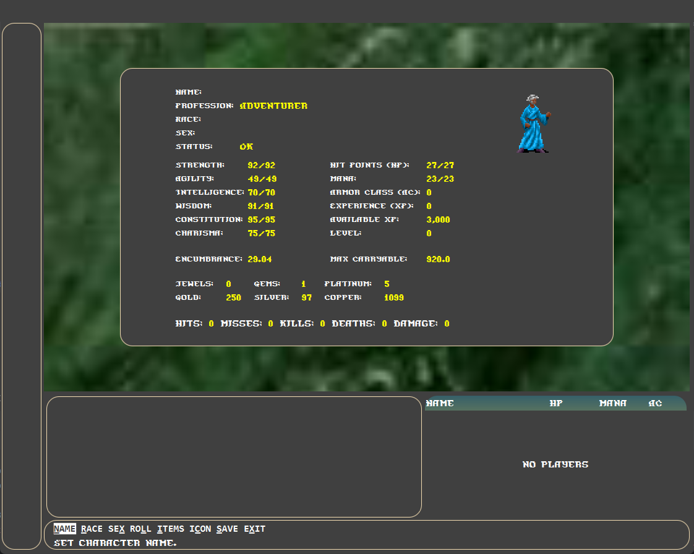
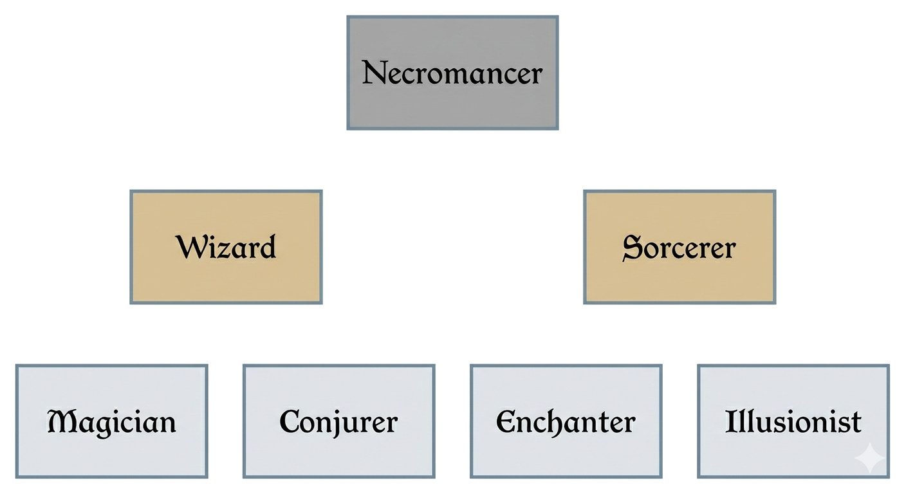
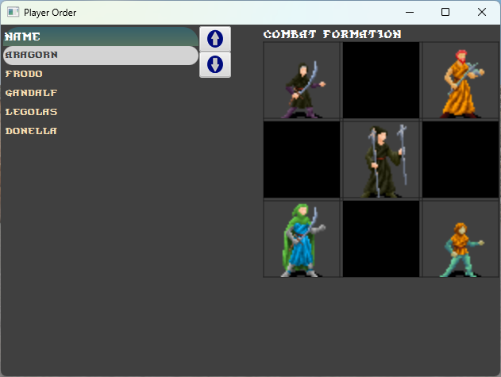
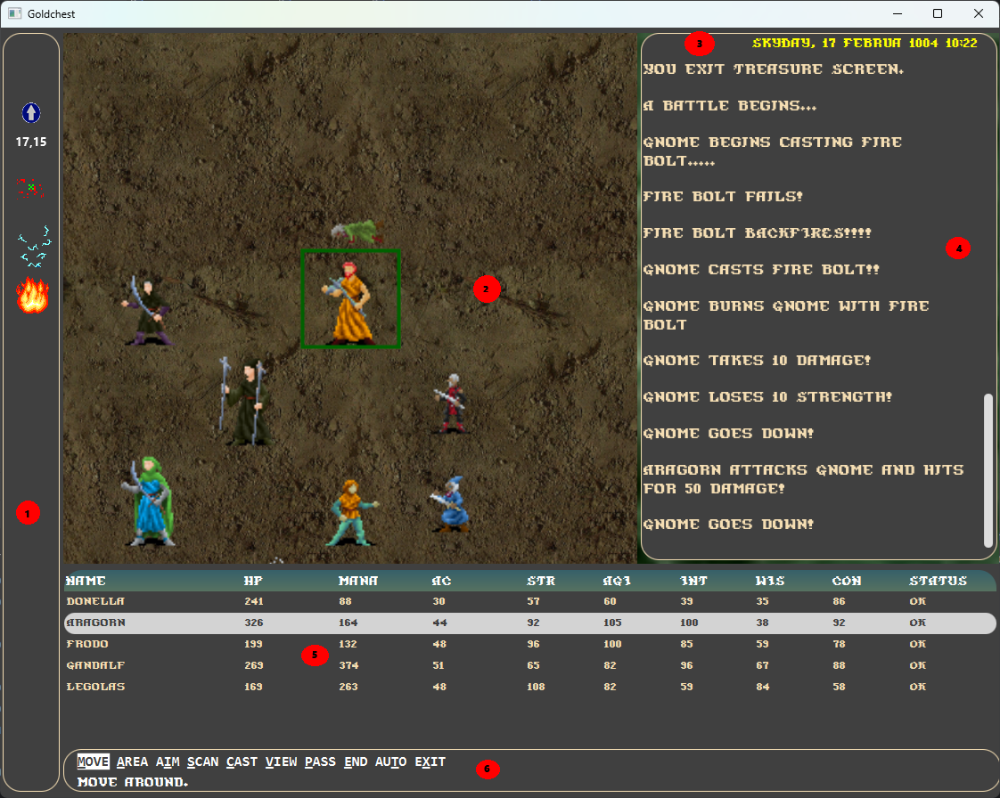
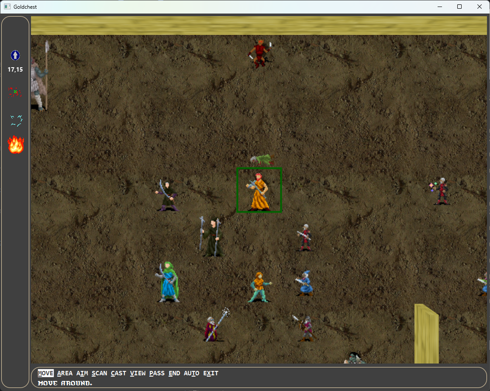

# Goldchest Manual

[//]: # (https://www.w3schools.com/howto/howto_html_include.asp)

[//]: # ( 

 )

## Introduction

blah blah blah

Blah features up to 9 party members (6 is usual to allow for NPCs in the party). Tactical combat.
2 distinct magic systems, experience for exploration,

## Game User Interface

Goldchest keeps to the old skool keyboard user interface. Use left and right arrow keys to
navigate the menus, press `<enter>` to select the option or use the underscored letter as a hot key.
Use the up and down arrow keys to
highlight different players in your party or to highlight items in your inventory or items from
stores etc...

Mouse wheel is also supported for scrolling if needed.

A numeric keypad is recommended for combat to move at angles, although you can use following keys
as well:

    Q W E   U I O
    A   D   J   L
    Z X C   M , .

#### Movement

In the 3d view use left and right keys to turn and the up arrow key to move forward.
The down arrow key turns 180. 

## Characters

Characters can use any of 4 basic classes: Fighter, Thief, Cleric and Mage. They can freely
choose any combinations of these classes when leveling (up to 20 levels total available).

Each of these classes has a guild for training and leveling. Characters can use any guild for ability training
though some guilds don't train for everything. The Cleric guild is the temple.

Characters start at level 0 (with some money and equipment).

### Classes

#### Fighter

Battle hardened by life, Fighters can use all weapons and armor. They gain an extra attack every 3 levels.

#### Cleric

Holy crusaders eschew edged and ranged weapons, preferring blunted maces, staffs or hammers.
They can wear any armor and gain an extra attack every 4 levels.
Clerics seek out holy places to learn wisdom giving them holy powers of healing
and powers against the undead.

#### Thief

This highly versatile profession can be proficient with any single handed weapon but is limited to
lighter armor since they need their dexterity for shoplifting, pick pocketing, looting, infiltration
and unlocking/disarming treasure chests. They gain an extra attack every 4 levels.

#### Mage

Acolytes of the mystic arts are limited to one handed swords, daggers, staffs and slings and can't
usually wear most armor since they need dexterity for their spell casting.
While they only gain an extra attack every 5 levels, they compensate with magic spells.

### Races

#### Human

While possibly being of hardier stock, this character is nonetheless like you or me.

#### Elf

Patterned after the Tolkien elf, the elf is slight of build, frequently taller than a human, and
very inclined to magic.

#### Dwarf

The Dwarven people are short and stout, extremely strong and healthy, but not amazingly
intelligent.

#### Hobbit

Hobbits (Halflings) are slightly smaller than Dwarves but are nimble and dexterous.

#### Half-Elf

These cross breeds are usually blond and fair-skinned, like elves, and gel some added
size and strength from their human ancestry.

#### Gnome

Gnomes closely resemble dwarves, but have less hair and even shorter tempers. They are
also more magically inclined, as a rule.

### Character Attributes

Each character you create has six primary attributes which define their abilities.
When you create a character each attribute is randomly assigned a value up to 100 which
is equivalent to the maximum human value.

#### Strength

Strength is physical power and chiefly affects the amount of damage a character can do to an
opponent in hand-to-hand combat. Make sure your fighting characters are strong.

#### Agility

Measures general dexterity & nimbleness. A high score makes your characters harder to hit,
and helps them strike the first blow in combat. Magic spells and trap disarming require
good a agility score.

#### Intelligence

Intelligence is mental power. A high intelligence rating will enable your
Magic users to gain more mana for their spells.

#### Wisdom

Wisdom is the character’s enlightenment, judgement, wile, will power  
and intuitiveness. A high wisdom enables your clerics to gain more mana.

#### Constitution

Constitution is the character's overall health affecting hit points gained per level and
their resistance to various substances and magical effects.

#### Charisma

Charisma affects how non player characters might interact with you.

### Character Statistics

#### Hit points

Measures the damage a character can take before they go down.

#### Mana points

Represents the current mental power of the character for spell casting and using skills.

#### Level

The general level of your character. Higher is better. When you gain a level you also
gain more hit points and mana points.

#### Armor class

Protection based on armor, shields, clothing, abilities and magic.

#### Experience points

Experience earned from quests, exploration and fighting monsters. These points can be
spent on gaining levels and learning new skills/abilities.

#### Coins/Gems/Jewels

There are multiple money types in the realm.

- Platinum = 5 gold
- Gold = 1 gold
- Silver = 1/50 gold
- Copper = 1/100 silver

In addition, gems and jewels are worth a significant amount of gold but they require someone to
appraise them for their value in exchange for gold.

Most transactions are done in gold coins.

#### Encumbrance/Max Carryable

Items and coinage have weight in the game. The more stuff you lug around the more
encumbered you will be. Encumbered characters are slowed down in combat.

## Character Creation

To create a character in the game, choose CREATE from the startup menu. Specify name, race and sex,
then ROLL until you are happy with the attributes and then chose ITEMS to pick some start up items for
your new character 
(if you don't pick any you get a bonus on your lowest attribute score instead).

The character ICON is generated randomly but you can change it at any time.

Characters start out as adventures at level zero. You need to find an appropriate place to level up
and receive other training.

## Weapons

There are various weapons in the game which have associated abilities (see [Abilities](#abilities)).
The associated abilities provide bonuses to-hit chance for the player. Once a player has acquired all
abilities associated with a Melee weapon, that weapon will be treated as though it's a 1 handed weapon
even if it normally is a 2 handed weapon.

## Abilities

### Ability Types

#### Melee

For each melee weapon type there's an associated ability and an advanced version.
e.g. Mace has Mace Weilding and Advanced Mace Weilding.
Basic proficency gives you a better chance to hit monsters. Advanced can periodically
do a critical hit (using some mana points).

Some weapon types are throwable (Axe, Hammer, Dagger) and require throwing abilites and marksmanship to
gain full proficiency.

#### Range

There are a variety of range attack abilities like Marksmanship, Bowmanship.
Marksmanship is useful for any ranged or thrown weapon. Bowmanship is useful
for bowed weapons e.g. Long Bow or Cross Bow. Some of these can have a special
attack as well.

#### Special abilities

##### Guarding

Characters automatically guard when they end their turn as long as they haven't cast a spell or are using a ranged weapon.
This means they will get a *single* melee attack if an enemy moves within their melee range.
Training this ability means the character will continue guarding even after doing that attack.
In addition, the melee attack will only use 1 move point rather than the usual 2 points.

##### Botany

Characters trained on botany will be able to identify plants while in combat
since some of those plants may have effects on the character when they stand
on them.

##### Basic cartography

Characters trained on basic cartography will show the party coordinate in any game region.
Additionally, if an area has a map purchased from a general store, the party will be able to see
extra details on the map like locations of shops and other interesting areas. If the area doesn't
have a map, basic cartography will allow the party to see a small surrounding region of the map.

##### Advanced cartography

Characters trained on advanced cartography will be able to auto-map areas that don't have maps.

##### Tactics

Higher level fighters can train on tactics. This ability gives the player the
option of seeing an area map of the combat arena. In addition Tactics will give the
party a mini map in combat showing the general location of monsters.

##### Pick pocket

Thieves may opt to learn the art of pick pocketing. This skill gives a chance
of grabbing items/money from opponents when the character does a melee attack.

##### Looting

Thieves learning the art of looting may collect items/money from dead opponents in combat.

##### Disguise

Thieves learning the art of disguise may opt to disguise as dead monsters in combat. Disguised characters
are ignored by enemy monsters. The disguise is lost when doing a melee attack unless it was a backstab.

##### Infiltration

High level thieves may study the skill of infiltration. Infiltration is an advanced form of disguise
allowing the character to disguise as any monster type or size. In addition, the character
will have a higher chance of maintaining this disguise even when doing a melee attack.

##### Backstab

Thieves learning the art of backstabbing will double their melee attack damage when striking an opponent from behind.

##### Disarm

Thieves with this skill can periodically knock the oppenents primary weapon out of their hands
making them do less damage.

#### Disable

Thieves with this skill can periodically stun an opponent making them imobile
for the rest of the combat round.

*NOTE: Some Monsters also have special attacks.*

## Places

Towns, villages and wilderness areas may contain these places worth visiting.
Guilds and Temples are especially useful for training and leveling characters.
Often shop owners can give you interesting information if you talk to them.

### Armory

Armories buy and sell weapons, armor and ammunition. The proprietors can identity some items for you as
well - for a price.

### Blacksmith

The blacksmith will buy and sell weapons and armor usually at a better price than the armory but with mixed quality.
The proprietors can identity and repair some items for you as well - for a price.

### Tavern

Visit taverns to hear rumours and recruit NPCs into the party. Don't drink too much though.

### Inn

Inns are safe places to rest in exchange for some gold. Resting restores some hit points and mana.
Resting also give characters time to study new skills and abilities that they've learned at the
various guilds.

### Temple

Temples are divine places of complete healing and where clerics go to study.
Clerics who are worthy may pray here to acquire cleric spells from ancient holy tomes.

### Fighter Guild

Everything you need to know about killing monsters is here.

### Mage Guild

Libraries of everything known about the mystical arts. Proprietors can usually identify magical
items for you.

### Thief Guild

Dens of villainy where scums of the earth plan vicious deeds upon the unsuspecting peasantry.
Your thief will feel right at home here.

### General Store

Carries common items useful for adventuring.

### Taylor

Buys, sells and repairs clothing and leather goods.

### Bank

A storehouse for items and money when your characters get too rich to bother carrying everything they have.
When you're poor, you can get loans but be careful to pay them back unless you want concrete galoshes.

### Jeweler

Jewelers buy and sell gems and jewels. They will usually offer you the best price when appraising.

## Magic System

Mages may learn new spell books every other level. Any of the basic level spell books are available.
Wizard requires that the character has aquired Magician and Enchanter.
Sorcerer requires that the character has aquired Conjurer and Illusionist.

Sorcerer and Wizard also require the character to be at least a level 8 Mage.

The most powerful mage the Necromancer requires level 20 Mage and all the other spell books.

## Current Spell List

duration in minutes

#### Conjurer

~~~
Code	Level	Range	Duration	Mana	Type	Spell
fiba	7	6.0	0	20	Fire	Fire ball
fibo	3	6.0	0	7	Fire	Fire bolt
sudf	3	6.0	0	12	Earth	Summon Giant Gold Dragon Fly
suwo	5	6.0	0	10	Earth	Summon Wolf
emel	3	0.0	0	7	Skill	Emergency light
~~~

#### Enchanter

~~~
Code	Level	Range	Duration	Mana	Type	Spell
enla	5	0.0	0	10	Magic	Enlarge
hast	3	0.0	1440	20	Magic	Haste
itom	2	3.0	0	20	Skill	Immunity from magic
prom	2	3.0	720	20	Skill	Protection from magic
stre	3	1.5	1440	20	Magic	Strength
engl	4	1.0	1440	10	Magic	Enchanted glow
~~~

#### Illusionist

~~~
Code	Level	Range	Duration	Mana	Type	Spell
fear	4	1.5	25	20	Mind	Fear
feeb	8	4.0	60	20	Mind	Feeble mind
refe	6	6.0	0	40	Mind	Remove Fear
ilwo	7	6.0	0	20	Illusion	Illusionary Wolf
~~~

#### Magician

~~~
Code	Level	Range	Duration	Mana	Type	Spell
mami	1	6.0	0	10	Magic	Magic Missile
shgr	4	1.5	0	15	Magic	Shocking Grasp
stcl	5	6.0	100	20	Air	Stinking Cloud
sual	1	2.0	0	2	Earth	Summon Horned Rabbit
tepo	7	8.0	0	30	Magic	Teleport
orbl	1	1.0	720	7	Magic	Orb of light
~~~

#### Sorcerer

~~~
Code	Level	Range	Duration	Mana	Type	Spell
deil	12	0.0	0	60	Mind	Destroy Illusions
ilbd	12	6.0	0	30	Illusion	Illusionary Black Dragon
mafe	8	6.0	60	40	Mind	Mass Fear
glob	7	3.0	720	60	Magic	Minor globe of invulnerability
orfe	6	6.0	60	20	Mind	Orb of Fear
stup	8	4.0	0	40	Mind	Stupify
terr	12	1.5	50	40	Mind	Terrify
mifs	5	6.0	0	7	Mind	Mind Fist
~~~

#### Wizard

~~~
Code	Level	Range	Duration	Mana	Type	Spell
disp	10	6.0	0	30	Mind	Dispossess
fibl	8	8.0	0	30	Fire	Fire blast
fist	10	8.0	0	40	Fire	Fire storm
poss	12	6.0	720	30	Mind	Possession
stst	8	6.0	200	40	Air	Stink Storm
subd	12	6.0	0	60	Earth	Summon Black Dragon
subl	12	8.0	0	80	Earth	Summon Blue Dragon
sugs	7	6.0	0	20	Earth	Summon Giant Skeleton
icbl	8	8.0	0	30	Cold	Ice blast
~~~

#### Necromancer

~~~
Code	Level	Range	Duration	Mana	Type	Spell
susg	16	12.0	0	100	Air	Summon Cloud Genie
~~~

## Magic Items

Various magic items can be found throughout the game including weapons, armor, shields, etc.
These are other common types of items that can be found and how they work.

Some may have negative effects or may be cursed (not able to drop or unequip).

Items appear usually in an unidentified state. You may check a variety of shops to see if they can identify for you.

Characters with certain abilities may identify items automatically.

### Potions

Potions are single use with a variety of spell effects. Some can be used in camp as well as combat.
They can only be used on yourself.

### Wands

Wands may have multiple uses and require hands to use. You may use them as a melee weapon as well if you're desperate.

### Scrolls

Scrolls are single use with a variety of spell effects. Some can be used in camp as well as combat.
Scrolls can also be memorized by players, so they can cast the spell even if they have no magic or spell books.

### Rings

Rings have a variety of effects that happen when you equip them.

## Cursed items

Items may be cursed. Cursed items have the following characteristics:

* If equipped they cannot be unequipped. The curse will need to be removed at a temple or by cleric with remove curse spell.
* If unequipped they can be identified and dropped - but they cannot be traded, sold or deposited.
* Usually they will have negative consequences to the character while they are in the character's possession.
* Magic cursed items will usually have a negative consequence if used.
* They do not wear out over time due to use or damage. They can only be removed at a temple.
* Cursed scrolls if memorized will remove spells from your spell books and drain intelligence. The effects will revert once you remove the
  cursed item.
* Players who are cursed cannot equip any item.
* Cursed weapons will make the character worse on attacks.
* Cursed armor (Armor, Boots, Bracers, Clothes, Gloves, Helm, Shield) will give the character low protection even though it appears the
  character has protection.

*Note: Items may become cursed if shoplifted.*

## Combat

While some areas of Goldchest are safe to travel, many areas are dangerous and inevitably
you'll encounter others who would rather you didn't exist in the universe.

When you have an encounter you will usually have 3 options:

FIGHT - Begin combat immediately.

RUN - Attempt to run away. If you fail, combat will begin immediately and possibly
the monsters will get the initiative.

QUICK - Quick combat runs combat quickly in "automatic" (AI) mode where you have no
option to interact in the outcome. Players will play in AI mode until monsters or
the party is defeated.

*QUICK mode is meant for scenarios where your party encounters monsters that you
have defeated in the past and are fairly sure that that can do so again. It's
probably not a good idea to use this when encountering new monsters.*

### Combat initiative

Once combat begins monsters will be laid out in the combat arena, players and
monsters usually start by mostly agility order. This can be different if your
party surprises the monsters you will get initiative and get some moves before the
monsters. On the other hand, monsters may surprise your party and get initiative.
In that case the monsters will move first and it's also
possible that your party will be scattered in combat (not in usual [formation](#combat-formation)).

### Combat formation

Party members can be placed in various positions in a 3x3 grid. 

Chose ORDER from the main menu and use drag-drop to place the characters.

You can also change the order the players appear in the game list.

### Combat screen

The combat area is divided into sections described below

##### (1) Effects Panel

The effects panel displays spells or abilities in effect for the selected
character. These may include compass, coordinate, mini-map, etc..

##### (2) Combat Panel

The combat panel displays characters and monsters within a certain area.
Pressing F3 during combat toggles between this view and full combat
panel view (see [Full screen combat](#combat-full-screen)).
The camera is centered on the selected player or monster. A box around
the selected player indicates health, green = good, yellow = slightly wounded,
red = badly wounded.

##### (3) Calendar

This displays the current calendar date and time.

##### (4) Text Panel

The text panel displays details of the action in scrolling text.

##### (5) Player Panel

The player panel displays players and summoned monsters including their attributes and
status.

##### (6) Menu Panel

If the selected character is user controlled you will see the combat menu.
Use the combat menu to move, select and cast spells, check inventory etc.
The combat menu contains most of what's available normally except trading
and dropping items.

*Note: A Thief can trade items to other characters if he/she is close enough.*

#### Combat Full Screen

Press F3 to toggle full screen combat and [normal combat screen](#combat-screen).

#### Automatic moves and Manual moves

NPCs and monsters are generally controlled by the game (auto-mode). Players will usually have
a combat menu to move and take other actions manually. The menu contains an AUTO option
to change the character to game controlled. Press F2 to put all players in to auto-mode,
press ESC to turn off auto-mode.

To move a chracter chose MOVE menu and use the direction keys. Moving at an enemy will do a melee attack.

*Note: Moving away from an enemy next to you gives them a melee attack against you. Same with monsters.*

*If an enemy is guarding then moving up to them will give them a melee attack against you. Same if you are guarding and they move to you.*

*Fighters gain attacks every 3 levels, clerics and thieves every 4 and Mage every 5. (you get X 2 when you are enlarged or hasted)*

### Monster types

Below are some common monster types that you may encounter.

#### Undead

Undead range from skeletons to zombies to ghouls to demons. Lowere undead
are usually pretty stupid but higher level ones can be smart and tricky.
Undead can be feared by cleric as well as being dispelled or destroyed based
on the cleric spell/ability used.
Some undead have special attacks like fear, posession and paralyze so be careful out there...

#### Fighters

There are a variety of fighter type opponents. Guards, warriors, archers etc.
Some have advanced fighing abilities including critical hits.

#### Thieves

Thieving opponents may have abilites like pick pocket, looting, disarm and disable.
Be careful letting them get too close.

#### Dragons

Fearsome creatures that can breath fire or have other similar attacks. They
can do extra damage at close range too.

#### Animals

Not usually too inteligent but can be fierce when angered or scared.

#### Insects

Insects in this world are not just annoying things to be simply swatted away.
Many are large and fast and can climb or fly over walls. Some are poisonous and spray acid.

#### Giants

Larger and more dangerous.

#### Gnomes/Orcs/Goblins

Families of these evil creatures abound in this world. None are too happy
to see you.

